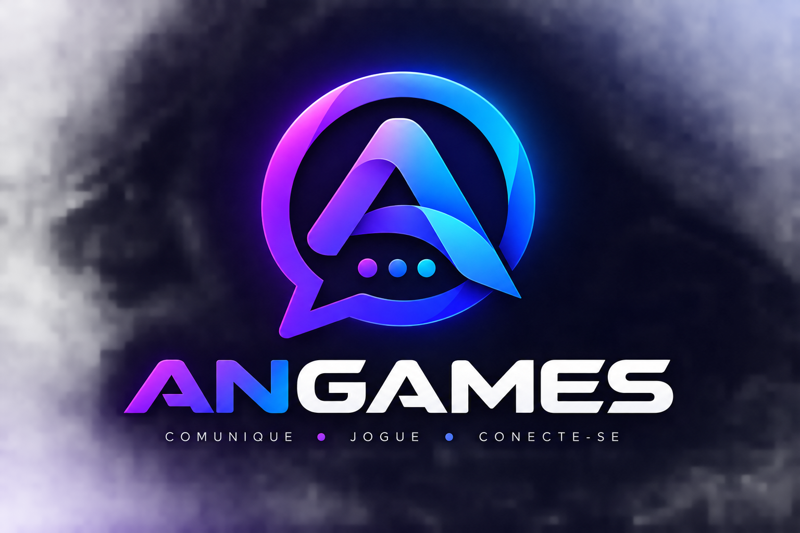
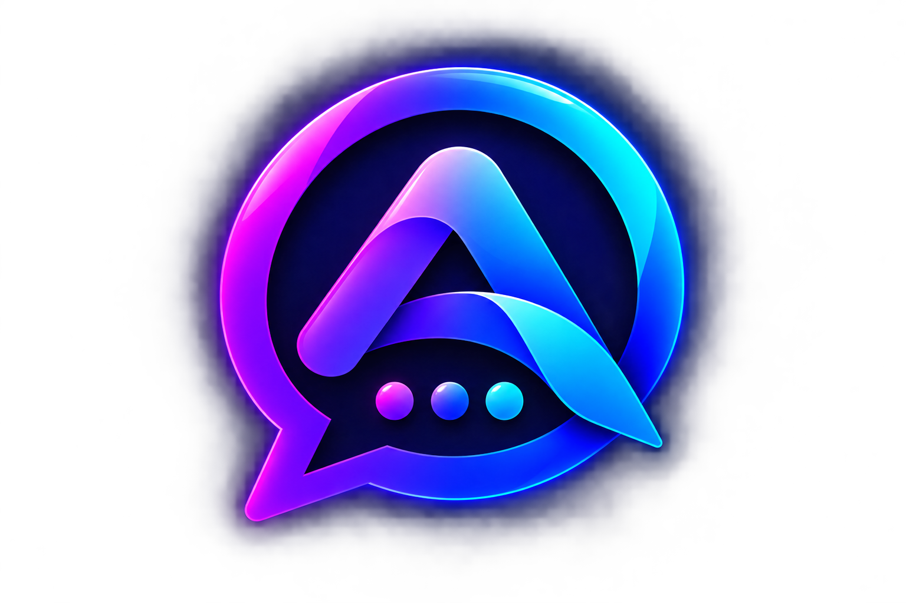
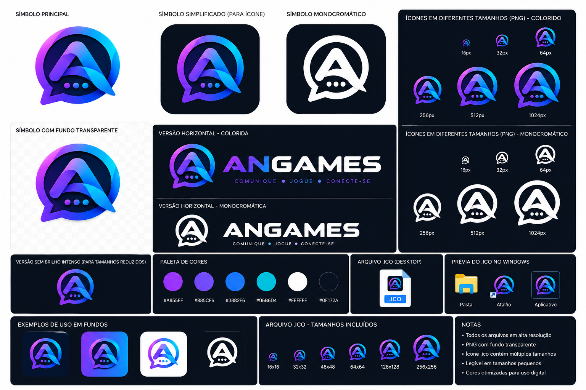

  

<h1 align="center">🎮 Angames</h1>

  <b>A Nova Experiência em Comunicação Gamer, Voz em Alta Definição e Comunidades.</b> 
  <i>Conecte-se com seus amigos, monte seu clã e jogue sem lag, com máxima privacidade e qualidade de áudio de estúdio.</i>

  
  
  
  

  <a href="https://angames.linkjohn.com"><b>🚀 ACESSAR A PLATAFORMA AGORA</b></a> • 
  <a href="#-como-começar-passo-a-passo"><b>📖 GUIA RÁPIDO</b></a> • 
  <a href="#-planos-servidores-dedicados--contato"><b>💼 PLANOS & PARCERIAS</b></a>

---

## 📌 Sumário
- [🌟 Por que escolher o Angames?](#-por-que-escolher-o-angames)
- [✨ Galeria do Aplicativo](#-galeria-do-aplicativo)
- [🔥 Principais Funcionalidades para Você e sua Equipe](#-principais-funcionalidades-para-você-e-sua-equipe)
- [🚀 Como Começar (Passo a Passo)](#-como-começar-passo-a-passo)
- [📱 Onde Usar (Multiplataforma)](#-onde-usar-multiplataforma)
- [💼 Planos, Servidores Dedicados & Contato](#-planos-servidores-dedicados--contato)
- [👑 Idealização & Comunidade](#-idealização--comunidade)

---

## 🌟 Por que escolher o Angames?

O **Angames** nasceu para oferecer aos gamers e criadores de conteúdo uma alternativa mais rápida, limpa e focada no que realmente importa: **jogar junto sem interrupções**.

- ⚡ **Zero Lag nas Chamadas**: Conexões otimizadas para que seu ping em jogos competitivos (CS2, Valorant, LoL, FiveM, Warzone) permaneça estável.
- 🎙️ **Cancelamento de Ruído Inteligente**: Jogue com tranquilidade! Barulhos de teclado mecânico, ventilador e ruídos de fundo são filtrados automaticamente.
- 🔒 **Privacidade Real**: Suas conversas pertencem a você. Não coletamos nem comercializamos seus dados com terceiros.
- 🎨 **Ambiente Moderno e Personalizável**: Crie seu espaço com identidade própria, canais organizados, cargos com cores exclusivas e status customizados.

---

## ✨ Galeria do Aplicativo

  

  
  

---

## 🔥 Principais Funcionalidades para Você e sua Equipe

### 🎙️ Salas de Voz & Chamadas Privadas
- **Entrada e Saída Instantânea**: Conecte-se às salas de voz com 1 clique.
- **Chamadas Diretas (DMs)**: Ligue para seus amigos individualmente com toque sonoro em tempo real.
- **Transmissão de Tela em HD**: Mostre sua gameplay ou assista a transmissões de amigos em alta qualidade.

### 💬 Mensagens Instantâneas & Mídia
- **Chat Completo**: Envio de mensagens em tempo real com suporte a emojis, menções e respostas diretas.
- **Busca de GIFs Integrada**: Envie GIFs e reações instantâneas para animar as conversas.
- **Compartilhamento de Arquivos**: Envio rápido de fotos, prints e vídeos diretamente no chat.

### 🛡️ Servidores para Comunidades e Equipes
- **Criação Rápida de Servidores**: Crie o servidor do seu grupo ou guilda em segundos.
- **Cargos e Hierarquia**: Defina quem é Moderador, Membro VIP ou Líder com cores e privilégios específicos.
- **Canais por Categoria**: Separe salas de bate-papo, canais de anúncios e salas de call por jogo.

---

## 🚀 Como Começar (Passo a Passo)

Começar no Angames leva menos de 1 minuto:

### Passo 1: Acesse a Plataforma
Acesse o endereço oficial no seu navegador preferido:  
👉 **[https://angames.linkjohn.com](https://angames.linkjohn.com)**

### Passo 2: Crie sua Conta
1. Clique em **"Criar uma conta"**.
2. Preencha os campos:
   - **Usuário**: Escolha seu apelido único (ex: `joaogamer`, `balla`, `proplayer`).
   - **Nome de Exibição**: Como você deseja aparecer para os outros (ex: `João Vitor`).
   - **Email**: Seu email para acesso e recuperação.
   - **Senha**: Crie uma senha segura com no mínimo 12 dígitos.
3. Clique em **Criar conta**.

### Passo 3: Adicione Amigos ou Crie seu Servidor
- Clique no ícone de **`+`** no menu lateral esquerdo para criar o seu próprio servidor.
- Envie o convite para seus amigos e comece a conversar por voz e texto!

---

## 📱 Onde Usar (Multiplataforma)

O **Angames** foi projetado para estar com você onde você estiver:

| Plataforma | Como Acessar | Vantagens |
|:---|:---|:---|
| 🌐 **Navegador Web** | Acesse [angames.linkjohn.com](https://angames.linkjohn.com) | Sem instalação necessária, rápido e direto em qualquer PC |
| 💻 **Aplicativo PC (Windows)** | Instalador executável desktop | Desempenho otimizado para jogos e atalhos rápidos |
| 📱 **Smartphone (Android / PWA)** | Aplicativo PWA instalável ou APK | Receba notificações e atenda chamadas de voz de qualquer lugar |

---

## 💼 Planos, Servidores Dedicados & Contato

Você tem uma grande comunidade, guilda de MMORPG, time de e-Sports ou servidor de Roleplay (FiveM / SA-MP)?

Oferecemos **soluções sob medida**:
- 🏆 **Servidores com Recursos Isolados**: Infraestrutura com capacidade ampliada para centenas de usuários simultâneos em call.
- 🎙️ **Bitrate de Áudio de Alta Fidelidade**: Qualidade máxima de áudio para transmissões e podcasts ao vivo.
- 🛡️ **Suporte Prioritário & Personalização**: Ajuda na configuração de cargos, bots e integrações.

### 📬 Fale Conosco para Parcerias e Acesso:
- **Site Oficial**: [angames.linkjohn.com](https://angames.linkjohn.com)
- **Atendimento & Parcerias**: Entre em contato com a nossa equipe de suporte e vendas.

---

## 👑 Idealização & Comunidade

> ### 🏆 Dono e Idealizador: **BALLA**
> O **Angames** é um projeto fundado e liderado por **BALLA**, concebido para entregar a melhor comunidade de comunicação gamer do Brasil.

> ### 🚀 Conectividade & Hospedagem: **Linkjohn**
> Soluções de alta disponibilidade, conectividade e entrega de infraestrutura por **[Linkjohn](https://linkjohn.com)**.

---

  <b>Junte-se à comunidade Angames e eleve o nível das suas jogatinas!</b> 
  © 2026 Angames. Todos os direitos reservados.

